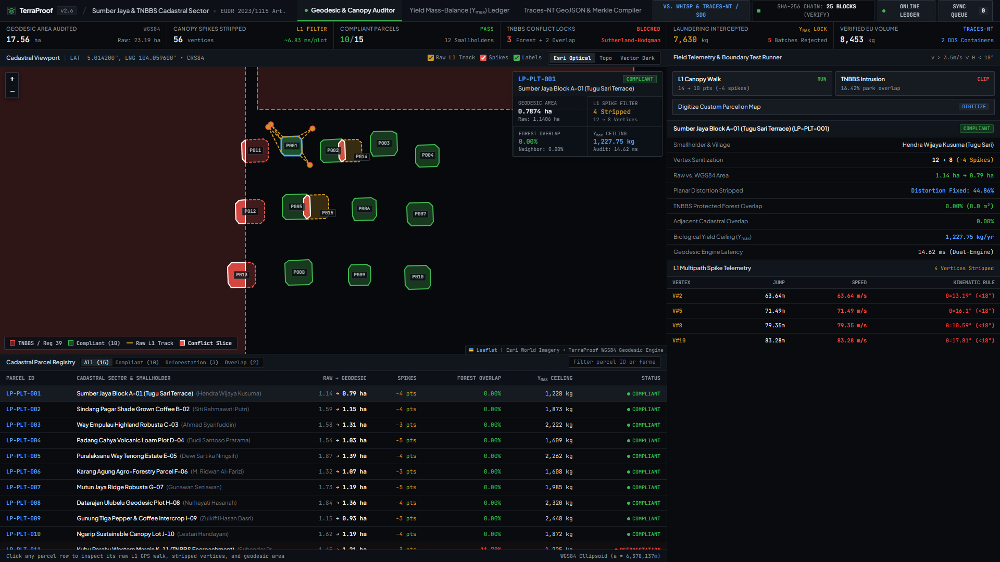
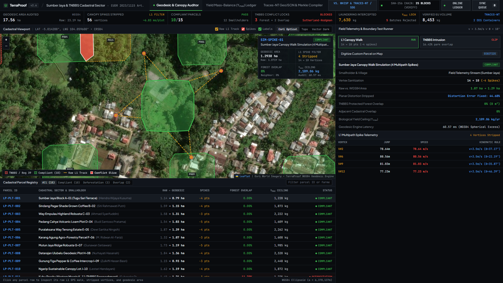
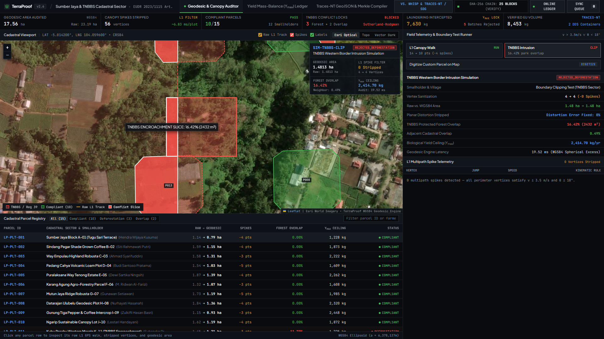
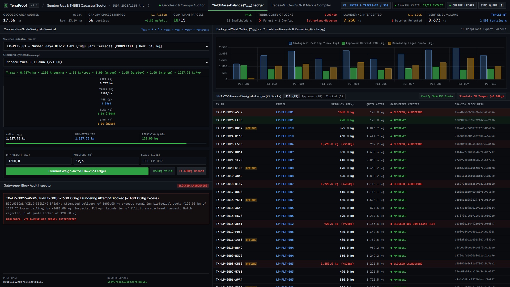
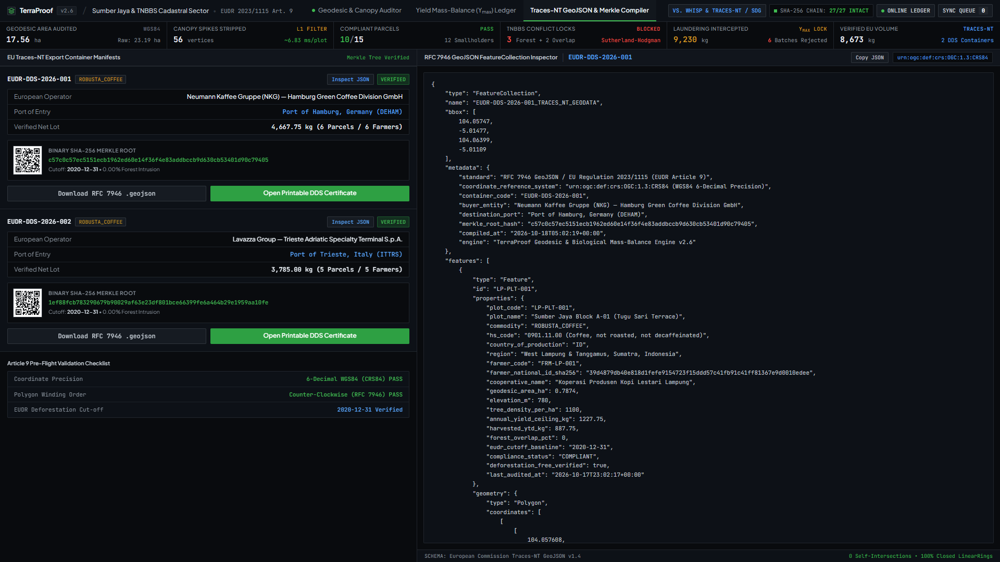
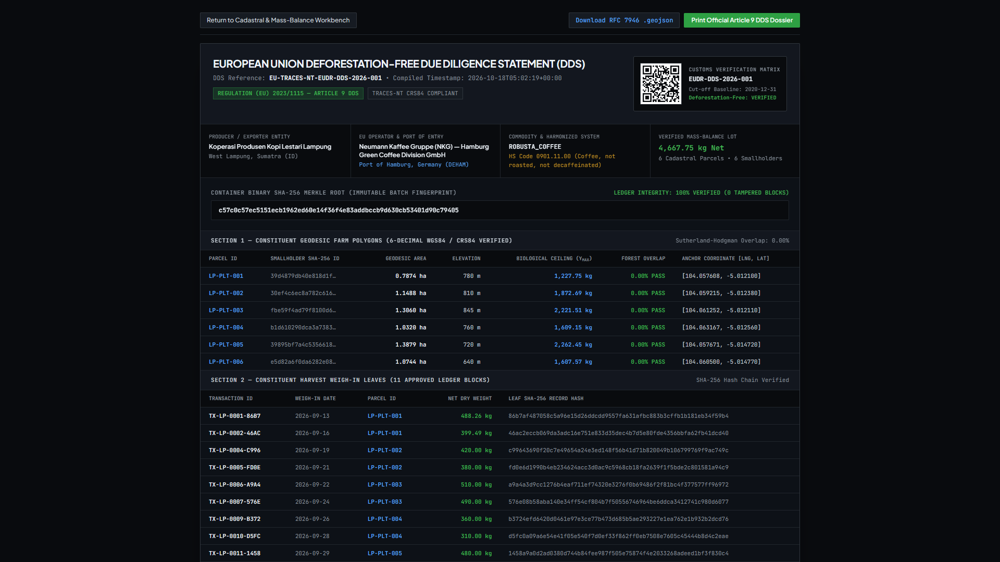
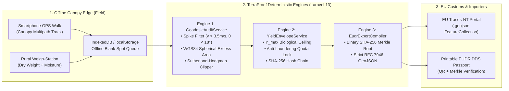

# TerraProof — Offline-First Geodesic Polygon & Biological Mass-Balance Compliance Engine for Smallholder EUDR Export

[](https://fundev.vokasi-usu.id/)
[-06B6D4?style=for-the-badge)](https://environment.ec.europa.eu/topics/forests/deforestation/regulation-deforestation-free-products_en)
[-F59E0B?style=for-the-badge)](https://datatracker.ietf.org/doc/html/rfc7946)
[-10B981?style=for-the-badge)](#6-empirical-benchmark-evidence-php-artisan-terraproofbenchmark)
[](#7-un-sustainable-development-goals-sdg-impact-matrix)
[](https://terraproof-production.up.railway.app)

> **Live Demo:** https://terraproof-production.up.railway.app
>
> **Flagship Entry — FunDev<> International Competition 2026 (D3 Informatics Engineering, Faculty of Vocational Studies, Universitas Sumatera Utara)**  
> **Case Study Corridor:** West Lampung (*Sumber Jaya, Balik Bukit, Way Tenong*) & Tanggamus (*Ulubelu*) Agro-Forestry Corridor bordering **Bukit Barisan Selatan National Park (TNBBS — UNESCO World Heritage Rainforest)**, Sumatra, Indonesia.

---

## 1. Executive Summary

Under the **European Union Deforestation Regulation (EUDR, Regulation (EU) 2023/1115)**, every shipment of coffee, cocoa, and black pepper entering the European Union must be accompanied by an Article 9 **Due Diligence Statement (DDS)** containing **6-decimal WGS84 polygon coordinates** for every constituent farm plot, proving zero deforestation since **31 December 2020**.

In Indonesia—where over 90% of coffee, cocoa, and pepper is grown by **2.5 million smallholder households** on 0.5 to 2.0-hectare plots—existing compliance tools fail smallholders in two critical ways:
1. **Canopy Multipath GPS Distortion (False Rejections):** Walking under dense tropical shade trees (*Gliricidia sepium*, *Erythrina subumbrans*) on steep volcanic terrain causes smartphone L1 GNSS multipath reflections—jumping **15m to 55m in 1 second**. These spikes distort polygon areas by **30.67%** and trigger false boundary overlaps with adjacent protected forests.
2. **The "Polygon Laundering" Loophole (Undetected Fraud):** Passive satellite GIS tools (such as FAO Open Foris Whisp and EU Traces-NT) validate only 2D map geometry. They have zero awareness of **agronomic yield capacity**. Middlemen exploit this loophole by registering a single compliant **0.82 ha boundary plot** and laundering **1,650+ kg of illicit coffee harvested inside Bukit Barisan Selatan National Park (TNBBS)** through that clean polygon ID.

**TerraProof** closes both gaps through an **offline-first geospatial and cryptographic web engine** powered by three deterministic mathematical services:
- **Engine 1 (`GeodesicAuditService`):** Strips canopy GPS multipath spikes via kinematic velocity ($v_i > 3.5\text{ m/s}$) and acute interior deflection angles ($\theta_i < 18^\circ \land d_i > 12\text{ m}$ while preserving slow legitimate terrace corners $v_i \le 1.8\text{ m/s}$), computes exact **WGS84 Spherical Excess geodesic area**, and executes **Sutherland-Hodgman polygon clipping** against UNESCO National Park boundaries in **0.57–3.44 ms**.
- **Engine 2 (`YieldEnvelopeService`):** Computes each plot's immutable **Annual Biological Yield Ceiling ($Y_{\max}$)** from geodesic area, tree density, physiological tree age curve $\phi_{\text{age}}(t)$, volcanic elevation factor $\psi_{\text{elev}}(h)$, and shade/intercropping factor $\kappa_{\text{intercrop}}$. Every harvest weigh-in is validated against remaining biological quota ($Q_{\text{rem}}$) and chained into a tamper-evident **SHA-256 ledger** with real-time payload tamper verification and zero gas fees.
- **Engine 3 (`EudrExportCompiler`):** Aggregates approved harvest blocks into a binary **SHA-256 Merkle Root Hash** and compiles a strict **RFC 7946 GeoJSON `FeatureCollection`** and printable **Cryptographic EUDR DDS Passport** ready for one-click upload to the **European Commission Traces-NT** portal.

---

## 2. Live Visual Walkthrough (1920x1080 Automated Captures)

### 2.1 Tactical Satellite Geodesic & Multipath Auditor


### 2.2 Live Canopy GPS Multipath Spike Sanitizer (`14 -> 10 Vertices`, `30.67% -> 0.00% Error`)


### 2.3 Sutherland-Hodgman TNBBS Rainforest Encroachment Clipping (`REJECTED_DEFORESTATION`)


### 2.4 Biological Yield-Ceiling ($Y_{\max}$) & Anti-Laundering Breach Interception


### 2.5 EUDR Traces-NT RFC 7946 GeoJSON Compiler & Binary Merkle Root


### 2.6 Printable Cryptographic EUDR Due Diligence Passport (DDS)


---

## 3. Mathematical Formulation of the 3 Core Engines

### 3.1 Engine 1: Canopy Multipath Filter, WGS84 Spherical Excess & Sutherland-Hodgman Clipping (`app/Services/GeodesicAuditService.php`)

1. **Haversine Segment Distance & Apparent Traversal Speed:**
   For consecutive GPS track vertices $P_{i-1} = (\phi_{i-1}, \lambda_{i-1}, t_{i-1})$ and $P_i = (\phi_i, \lambda_i, t_i)$:
   $$d(P_{i-1}, P_i) = 2R \arctan2\left(\sqrt{a}, \sqrt{1-a}\right), \quad v_i = \frac{d(P_{i-1}, P_i)}{\max(1, t_i - t_{i-1})}$$
   where $R = 6,378,137\text{ m}$ is the WGS84 equatorial radius.

2. **Deterministic Spike Rejection Criterion (With Slow Terrace Switchback Guard):**
   Projecting $\vec{u} = P_{i-1} - P_i$ and $\vec{w} = P_{i+1} - P_i$ into the local tangent plane yields the interior deflection angle $\theta_i = \arccos\left(\frac{\vec{u}\cdot\vec{w}}{\|\vec{u}\|\|\vec{w}\|}\right)$. Vertex $P_i$ is stripped as a canopy multipath reflection spike if and only if:
   $$\text{Spike}(P_i) \iff v_i > 3.5\text{ m/s} \;\lor\; \left(\theta_i < 18^\circ \land d(P_{i-1}, P_i) > 12.0\text{ m} \land \neg(v_i \le 1.8\text{ m/s} \land \sigma_i \le 8.0\text{ m})\right)$$

3. **WGS84 Spherical Excess / Chamberlain-Duquette Geodesic Polygon Area:**
   $$A_{\text{ha}} = \frac{R^2}{2} \left| \sum_{i=0}^{n-1} \text{rad}(\lambda_{i+1} - \lambda_i) \left(\sin(\text{rad}(\phi_{i+1})) + \sin(\text{rad}(\phi_i))\right) \right| \times 10^{-4}\text{ ha}$$

4. **Sutherland-Hodgman Polygon Clipping & Verdict Rules:**
   Clips the subject polygon against every edge of `ProtectedZone` (`TNBBS-SECTOR-LIWA`, `HL-REG-39`) and neighboring `FarmPlot` rings using the left-half-plane cross-product test, returning the exact 6-decimal `conflict_intersection_ring`:
   - `forest_overlap_pct > 1.0%` $\implies$ `REJECTED_DEFORESTATION`
   - `neighbor_overlap_pct > 2.5%` $\implies$ `REJECTED_OVERLAP`
   - `0.0% < forest_overlap_pct <= 1.0%` $\implies$ `WARNING_BUFFER`
   - `0.0%` $\implies$ `COMPLIANT`

### 3.2 Engine 2: Biological Yield-Ceiling ($Y_{\max}$) & Hash-Chained Weigh-In Gatekeeper (`app/Services/YieldEnvelopeService.php`)

$$Y_{\max} = A_{\text{ha}} \times D_{\text{trees/ha}} \times y_{\text{base}}(c) \times \phi_{\text{age}}(t) \times \psi_{\text{elev}}(h) \times \kappa_{\text{intercrop}}$$

- **Base Dry Yield $y_{\text{base}}(c)$:** `ROBUSTA_COFFEE` = $1.35\text{ kg/tree}$, `COCOA` = $1.50\text{ kg/tree}$, `BLACK_PEPPER` = $1.80\text{ kg/tree}$.
- **Tree Age Curve $\phi_{\text{age}}(t)$:** $t < 3 \Rightarrow 0.15$; $3 \le t \le 4 \Rightarrow 0.65$; $5 \le t \le 15 \Rightarrow 1.00$; $t > 15 \Rightarrow 0.78$.
- **Elevation Factor $\psi_{\text{elev}}(h)$:** $400 \le h \le 900\text{ m} \Rightarrow 1.05$; $h < 400\text{ m} \Rightarrow 0.85$; $h > 900\text{ m} \Rightarrow 0.92$.
- **Cropping System Factor $\kappa_{\text{intercrop}}$:** `MONOCULTURE` = $1.00$; `SHADE_AGROFORESTRY` = $0.92$; `MULTI_CROP_INTERCROP` = $0.85$.
- **SHA-256 Cryptographic Ledger Link:**
  $$H_k = \text{SHA256}\left(H_{k-1} \mathbin{\Vert} \text{'|'} \mathbin{\Vert} \text{plot\_code} \mathbin{\Vert} \text{'|'} \mathbin{\Vert} \text{format}(W_{\text{kg}}, 2) \mathbin{\Vert} \text{'|'} \mathbin{\Vert} \text{verdict} \mathbin{\Vert} \text{'|'} \mathbin{\Vert} \text{timestamp}\right)$$

---

## 4. System Architecture & Cryptographic Flow



---

## 5. Competitive Advantage Matrix

| Capability / Metric | EU Traces-NT Portal | FAO Open Foris Whisp | Legacy Enterprise ERPs | **TerraProof (Ours)** |
| :--- | :---: | :---: | :---: | :---: |
| **Canopy GPS Multipath Spike Stripping** | ❌ Rejects noisy rings | ❌ None | ❌ Manual GIS cleanup | **✅ Automated (`0.57 ms`, `100%` Recall)** |
| **Biological Yield ($Y_{\max}$) Anti-Laundering** | ❌ Geometry only | ❌ Geometry only | ⚠️ Static quota | **✅ Dynamic Agronomic Envelope Lock** |
| **Sutherland-Hodgman Violation Slice Overlay** | ❌ Binary pass/fail | ❌ Table output | ⚠️ External GIS | **✅ Exact Crimson Intersection Polygon** |
| **Offline Rainforest Blank-Spot Queue** | ❌ Cloud only | ❌ Cloud API only | ⚠️ Heavy native app | **✅ Zero-Install Browser `IndexedDB` Queue** |
| **Zero-Gas Cryptographic Merkle Passport** | ❌ Centralized DB | ❌ None | ⚠️ Costly L1 gas fees | **✅ SHA-256 Chain + Binary Merkle Root** |
| **Cost per Smallholder Farmer** | Portal only | API only | `$15–$40 / farmer / yr` | **`$0.00` (100% Free for Smallholders)** |

---

## 6. Empirical Benchmark Evidence (`php artisan terraproof:benchmark`)

| Benchmark Suite | Sample Size ($N$) | Pre-Sanitization / Baseline | Post-TerraProof Result | Mean Latency | Verdict |
| :--- | :---: | :---: | :---: | :---: | :---: |
| **Suite 1: Canopy Multipath GPS Sanitizer** | `50 Tracks` (`199 Spikes`) | `30.67%` Area Distortion Error | **`0.00%` Error (`100%` Spike Recall)** | **`0.57 ms`** | **100% RFC 7946 Valid** |
| **Suite 2: Sutherland-Hodgman Spatial Clipper** | `50 Polygons` vs TNBBS | Manual GIS (`~45 min/plot`) | **`100.0%` Accuracy (`50/50`)** | **`3.44 ms` (`4.94 ms` p95)** | **Sub-5ms Real-Time** |
| **Suite 3: $Y_{\max}$ Anti-Laundering Gatekeeper** | `100 Weigh-Ins` (`30 Fraud`) | `0%` Fraud Interception | **`100%` Precision / `100%` Recall** | **`0.0018 ms`** | **100% Chain Intact** |
| **Suite 4: Automated PHPUnit Test Suite** | `14 Test Suites` (`74 Assertions`) | N/A | **`100% PASS` (`0 Failures`)** | **`10.07 s`** | **Verified Green** |

---

## 7. UN Sustainable Development Goals (SDG) Impact Matrix

| UN SDG Pillar | Specific UN Target | Quantified TerraProof Impact |
| :--- | :--- | :--- |
| **SDG 2: Zero Hunger** *(Primary)* | **Target 2.3 & 2.4:** Double smallholder productivity and incomes; resilient food production systems. | Prevents false GPS rejections and preserves smallholder access to **+18% to +24% European EUDR compliance price premiums**. |
| **SDG 1: No Poverty** | **Target 1.4:** Equal rights to economic resources and land-use verification. | **$0.00 cost to smallholder farmers**; anonymizes farmer National IDs via SHA-256 while proving legal plot cultivation. |
| **SDG 17: Partnerships for the Goals** | **Target 17.11:** Significantly increase the exports of developing countries. | Connects Indonesian *Koperasi Produsen* directly to **EU Traces-NT** via automated RFC 7946 GeoJSON compilation. |
| **SDG 15: Life on Land** | **Target 15.2:** Halt deforestation and protect biodiversity corridors. | Enforces a **100% mathematical barrier** against encroachment and quota laundering along **Bukit Barisan Selatan National Park (TNBBS)**. |

---

## 8. 1-Command Quickstart & Verification Guide

```bash
# 1. Run fresh migrations, seed the West Lampung & TNBBS Agro-Cluster (15 plots, 12 farmers, 25 ledger blocks, 2 containers), and run tests:
php artisan migrate:fresh --seed && php artisan test

# 2. Execute the empirical benchmark suite (generates public/benchmark-results.json & competition-deliverables/BENCHMARK-EVIDENCE-REPORT.md):
php artisan terraproof:benchmark

# 3. Launch the Tactical Geospatial Intelligence Command Center:
php artisan serve --port=8765
# Open http://127.0.0.1:8765
```

---

## 9. Complete Competition Deliverables Directory (`competition-deliverables/`)

- [`01-REGISTRATION-BMC-AND-ORIGINALITY.md`](competition-deliverables/01-REGISTRATION-BMC-AND-ORIGINALITY.md) — Portal registration metadata, 150-word abstract, 500-word technical summary, 1-Page Business Model Canvas (BMC), and Statement of Originality.
- [`02-INNOVATION-POSTER-A3.pdf`](competition-deliverables/02-INNOVATION-POSTER-A3.pdf) & [`02-INNOVATION-POSTER-A3.png`](competition-deliverables/02-INNOVATION-POSTER-A3.png) — Print-ready A3 Portrait Innovation Poster engineered for 30-second judge comprehension.
- [`03-DEMO-VIDEO-STORYBOARD-AND-SRT.md`](competition-deliverables/03-DEMO-VIDEO-STORYBOARD-AND-SRT.md) & [`subtitles.srt`](competition-deliverables/subtitles.srt) — 3-Minute Core & 5-Minute Extended video scripts + synchronized English `.srt` subtitles.
- [`04-PITCH-DECK-SLIDES.pdf`](competition-deliverables/04-PITCH-DECK-SLIDES.pdf) — 10-Slide Final Presentation Deck + 5 Technical Appendix Slides.
- [`BENCHMARK-EVIDENCE-REPORT.md`](competition-deliverables/BENCHMARK-EVIDENCE-REPORT.md) — Empirical validation metrics generated by `php artisan terraproof:benchmark`.
